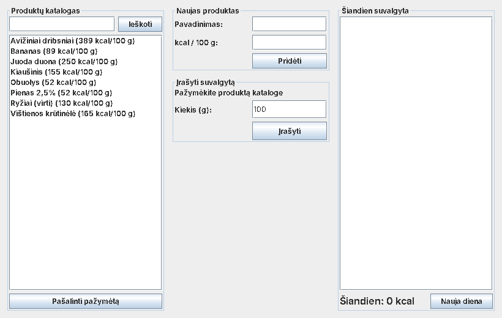

# Skip List & Calorie Tracker (Java)

My own implementation of a **skip list** data structure in Java, with a calorie tracker app built on top of it. Semester project for the **Data Structures** course at **Kaunas University of Technology (KTU)**.

**Tech:** Java, Swing, NetBeans



---

## Skip list
A skip list is a sorted linked list with several "express lanes". The bottom level holds every element; each higher level holds a random subset, so a search can skip over many elements at once.

- Generic `SkipList<E extends Comparable<E>>` implementing my own `SkipListADT<E>` interface
- `add`, `contains`, `remove` in **O(log n)** on average; `indexOf`, `get` in O(n)
- Node levels chosen randomly (p = 0.5, max 16 levels) – no rebalancing needed, unlike AVL / red-black trees
- Iterator, `toArray`, `toString`; duplicates rejected
- Correctness test: 150,000 random operations compared against `java.util.TreeSet`

## Calorie tracker
The product catalogue is stored in the skip list, always sorted alphabetically.

- **Swing GUI** (`KalorijuLangas`) and a console version (`KalorijuSkaiciuokle`)
- Search, add and remove products; log meals in grams; daily calorie total
- Input validation with user-friendly error messages

## Performance study (`Greitaveika`)
Skip list compared with `TreeSet`, a sorted `ArrayList` and a sorted `LinkedList` for 2,000–32,000 elements (3 runs each): add, contains, remove, iteration and memory usage.

| n = 32,000 | SkipList | TreeSet | ArrayList | LinkedList |
| --- | --- | --- | --- | --- |
| add all (ms) | 18.2 | 6.3 | 27.1 | 2,173 |
| 2,000 × contains (ms) | 1.1 | 0.4 | 0.3 | 762 |
| remove all (ms) | 31.9 | 14.4 | 70.0 | 4,819 |

The skip list is **hundreds of times faster** than a sorted linked list and beats a sorted array list on insert/remove at larger sizes; `TreeSet` (a highly optimised library class) is about 2–3× faster.

---

## Project structure
```
src/skiplistprojektas/calcalculator/
├── SkipListADT.java          interface
├── SkipList.java             skip list implementation
├── SkipListDemo.java         demo + correctness test
├── Greitaveika.java          performance study
├── Produktas.java            food product (Comparable by name)
├── KalorijuLangas.java       Swing GUI
└── KalorijuSkaiciuokle.java  console app
```

## How to run
Open the project in **NetBeans** and press **F6** to start the GUI. Run `SkipListDemo` or `Greitaveika` with **Run File** (Shift+F6).
